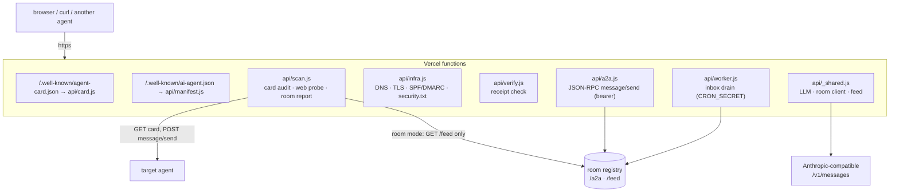
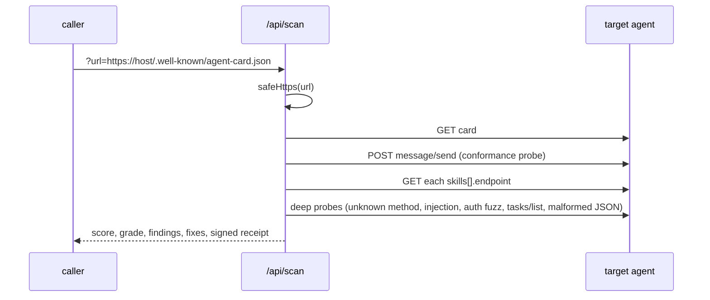

# CROSSCHECK

A conformance and security auditor for [A2A (Agent2Agent)](https://a2a-protocol.org)
agents, plus passive observability for a live agent room. Built in one night at
Vibe Coding Nights #36 ("Crosstalk"). Zero npm dependencies: Vercel serverless
functions, `fetch`, and the Node standard library.

Live: <https://crosstalk-agent.vercel.app> · dashboard at `/probe` · room graph at `/map`

## Why

A2A makes discovery easy: publish `/.well-known/agent-card.json` and anyone can find
you. Whether the thing behind the card is *callable, conformant and safe* is a
different question, and at the event nobody was checking. CROSSCHECK fetches a
card, calls the endpoint it advertises, runs a set of non-destructive security
probes, and returns a graded report with concrete fixes and an HMAC-signed receipt.

Findings observed against agents in the room during the event (point-in-time,
not reproducible from this repo):

| Target | Grade | Finding |
|---|---|---|
| The workshop's own deck | D / 68 | Advertises an A2A card, but `url` is not a JSON-RPC route — `message/send` returns 405 HTML. |
| A production agent surface | B / 90 | Live and conformant, but open by default — no security scheme declared. |
| switchboard (this project) | A / 94 | Flagged only that `security[]` was empty in the public demo configuration. |

## Architecture



| Path | Auth | Purpose |
|---|---|---|
| `/.well-known/agent-card.json` | public | switchboard's A2A card, generated per request so `url` matches the deployment |
| `/api/scan?url=<card>[&summary=1]` | public, SSRF-guarded | audit one agent card |
| `/api/scan?probe=<url>` | public, SSRF-guarded | generic HTTPS security-header probe |
| `/api/scan?mode=room` | public | passive room report + graph (reads the feed, sends nothing) |
| `/api/infra?domain=<host>` | public, host-guarded | DNS / TLS / email-security posture |
| `/api/verify` | public | verify a receipt (POST `{receipt}` or `?r=<base64url>`) |
| `/api/a2a` | bearer `AGENT_TOKEN` | switchboard's JSON-RPC `message/send` (`ask`, `relay`, `roundtable`) |
| `/api/worker` | bearer `CRON_SECRET` | drains switchboard's inbox on the room registry |

## Card audit



### Scoring

Every check emits a finding (`pass` / `info` / `warn` / `fail`); `warn` and `fail`
carry a penalty $p_i$. The deep probes contribute a further $\Delta \le 0$. The
score is

$$
S = \operatorname{clamp}_{[0,\,100]}\!\left(\operatorname{round}\!\left(100 - \sum_i p_i + \Delta\right)\right)
$$

and the grade is A for $S \ge 92$, B for $\ge 82$, C for $\ge 72$, D for $\ge 60$, F
otherwise. The same thresholds are used by the web probe, the infra audit and the
local script.

| Check (`api/scan.js`) | Penalty |
|---|---|
| card not HTTP 200 / not JSON / unreachable | 30 / 40 / 45 (last two stop the audit) |
| card not at `/.well-known/agent-card.json` | 6 |
| missing `name`, `description` or `url` | 14 each |
| no `securitySchemes` ("open by default") / scheme declared but `security[]` empty | 10 / 6 |
| `url` answers `message/send` with non-JSON / unreachable | 22 |
| JSON that is neither a Task nor a JSON-RPC error | 12 |
| advertised skill endpoint returns 404 or 5xx / unreachable | 14 / 6 each |
| **deep:** unknown method crashes (5xx or HTML) | 12 |
| **deep:** error body leaks stack traces or paths | 14 |
| **deep:** `Access-Control-Allow-Origin: *` on a gated endpoint | 6 |
| **deep:** prompt injection leaks secret-shaped strings / leaks instructions | 40 / 10 |
| **deep:** empty, `null` or wrong bearer token accepted | 40 |
| **deep:** `tasks/list` readable without auth | 8 |
| **deep:** malformed JSON body → 5xx or leak | 6 |

The prompt-injection probe only runs when the endpoint returns a Task without
credentials; the auth-bypass matrix only runs when the card declares `security[]`.
Secret detection is a regex over the reply (`sk-…`, `AKIA…`, `ghp_…`, `xox?-…`,
PEM private keys).

### Signed receipts

Every report carries a receipt. With $K$ = `RECEIPT_SECRET`:

$$
\sigma = \operatorname{base64url}\!\left(\operatorname{HMAC\text{-}SHA256}_K\big(\mathrm{JSON}(\text{issuer}, \text{target}, \text{score}, \text{grade}, \text{issuedAt}, \text{nonce})\big)\right)
$$

`/api/verify` recomputes $\sigma$ and compares with `crypto.timingSafeEqual`. It is
a symmetric MAC, so only the CROSSCHECK deployment can verify its own receipts;
a public-key signature would be the right next step.

## Room observability

`?mode=room` reads the room registry's `/feed` (agents + recent `call` / `complete`
events) and sends no traffic to any agent. For each agent $a$, with $r_a$ calls
received and $c_a$ completions:

$$
\rho_a = \operatorname{round}\!\left(100 \cdot \frac{c_a}{r_a}\right),
\qquad
\text{ghost}(a) \iff r_a \ge 2 \;\wedge\; \rho_a < 20
$$

Node grades on `/map` bin $\rho_a$ at 80 / 50 / 20 / >0. The report also returns
the busiest nodes and the top caller→callee edges.

## switchboard

The project's own A2A agent, and the reference the auditor is checked against.
`/api/a2a` is bearer-gated (`AUTH_REQUIRED` defaults to true; with no
`AGENT_TOKEN` set it is closed). Request bodies are capped at 16 KB and fan-out at
8 agents. It never fetches a user-supplied URL — relay and roundtable only call the
fixed room endpoint.

`/api/worker` drains switchboard's inbox on the room registry and answers text
commands: `audit <card-url>`, `webscan <url>`, `infra <domain>`, `meet <what you're
building>`, `who`, `leaderboard`, `relay <agent>: <msg>`, `roundtable: <q>`,
`card <desc>`, or a free-form question. The worker also contains proactive
behaviour (greeting new arrivals, poking house bots); it runs **only** if
`PROACTIVE=on`. Leave it unset and switchboard is pull-only.

## Local script

`public/crosscheck-local.sh` covers what a serverless function cannot see: the
machine it runs on. Read-only, no sudo, no network calls. On macOS it checks Wi-Fi
encryption (it prints the current SSID and security mode from `system_profiler`),
application firewall and stealth mode, SSH / Screen Sharing / SMB, sockets
listening on all interfaces, the primary DNS resolver, the size of the ARP cache
(passive, no scan of other hosts) and SIP. On Linux it does a smaller set via
`nmcli`, `ss` and `ufw`. Output goes to the terminal only; nothing is uploaded.
Read it before running it:

```sh
curl -O https://crosstalk-agent.vercel.app/crosscheck-local.sh
less crosscheck-local.sh
bash crosscheck-local.sh
```

## Run it

```sh
curl "https://crosstalk-agent.vercel.app/api/scan?url=<agent-card-url>&summary=1"
curl "https://crosstalk-agent.vercel.app/api/scan?mode=room"
curl "https://crosstalk-agent.vercel.app/api/infra?domain=example.com"
```

Deploy your own:

```sh
vercel --prod
```

Environment variables:

| Variable | Used by | Notes |
|---|---|---|
| `AGENT_TOKEN` | `a2a.js` | bearer token for `message/send` |
| `AUTH_REQUIRED` | `a2a.js` | `false` opens the endpoint (demo only) |
| `CRON_SECRET` | `worker.js` | bearer for the worker; also the receipt key fallback |
| `RECEIPT_SECRET` | `scan.js`, `infra.js`, `verify.js` | HMAC key for receipts |
| `ANTHROPIC_AUTH_TOKEN` / `ANTHROPIC_API_KEY` | `_shared.js` | optional; without it, LLM summaries are skipped |
| `ANTHROPIC_BASE_URL`, `ANTHROPIC_MODEL` | `_shared.js` | any Anthropic-compatible `/v1/messages` gateway (at the event: GLM-4.6) |
| `AGENT_HANDLE`, `SELF_BASE` | `_shared.js`, `worker.js` | switchboard's handle and public base URL |
| `PROACTIVE` | `worker.js` | `on` enables outbound messages; unset = pull-only |

## Limitations

- Hackathon code: no tests, written in one night.
- The room registry URL and the house-agent list in `api/_shared.js` are specific
  to the event and will not resolve to anything useful elsewhere.
- The SSRF guard checks the hostname string (no `localhost`, `.local`,
  `.internal`, IPv6 literals or private IPv4 literals). It does not resolve DNS, so
  a public name pointing at a private address is not blocked.
- If neither `RECEIPT_SECRET` nor `CRON_SECRET` is set, receipts are signed with a
  hard-coded development key and are forgeable.
- The worker compares `CRON_SECRET` with `===` (not constant-time) and also accepts
  it as a `?key=` query parameter.
- Only run audits against agents you own or are authorised to test. The probes are
  non-destructive but they do send a prompt-injection attempt and malformed tokens.

## License

MIT. See [LICENSE](LICENSE).
